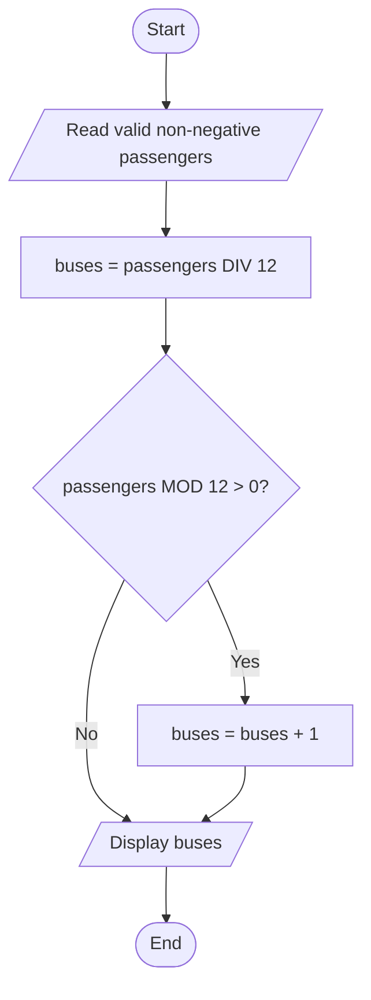

# From problems to algorithms

A good algorithm is precise enough for another person to execute and general enough to handle the intended inputs.

## The problem comes first

An algorithm is a finite, ordered set of unambiguous instructions for solving a problem. A computer program implements an algorithm in a programming language. An algorithm can be written on paper and executed by hand; it need not start with Python. “Choose the best route” is a goal, not yet an algorithm, because *best* and the method of choosing are unspecified.

Consider a school booking system. A minibus holds 12 passengers, and an outing has 29 passengers. The required output is 3 buses, not 2.4167 buses. State the input (a non-negative whole-number passenger count), output (a non-negative whole-number bus count), and rule (12 seats per bus). State that drivers are not included and that empty buses are not booked. These assumptions make the answer testable. A different seat count or a wheelchair space could change the problem, so assumptions belong in the specification.

A requirement says what must happen; an algorithm says how. Before coding, write one ordinary example, one boundary example, and one invalid example. For this problem they might be 29 → 3, 24 → 2, and -1 → an error. An error response is itself an output, rather than permission to invent a result for an invalid input.

## Four computational-thinking techniques

**Decomposition** divides the overall problem into manageable parts: obtain a passenger count, check it, calculate the number of buses, and report the result. Each part has a clear purpose. Dividing the code into arbitrary blocks of ten lines is not meaningful decomposition. The parts should correspond to tasks that can be understood and tested separately.

**Abstraction** keeps information needed for the model and leaves out irrelevant detail. Bus colour is irrelevant to seat capacity; available seats are essential. Abstraction does not mean removing every inconvenient detail. If a vehicle has different accessibility capacity, omitting that fact can make the model incorrect. Explain both the retained and omitted information when answering an abstraction question.

**Pattern recognition** notices similarities: 1–12 passengers need one bus, 13–24 need two, and 25–36 need three. Recognising a pattern suggests a solution, but testing only those examples does not prove it works for every input. Check zero and exact multiples, where a casual “always add one” approach fails.

**Generalisation** expresses the pattern as a reusable rule. For capacity `c > 0` and passenger count `n >= 0`, use integer division to calculate full buses and add one only when a remainder exists. Replacing a hard-coded answer for 29 passengers with a rule using `n` is generalisation. Replacing the fixed capacity with a parameter makes the same algorithm useful for different vehicles, if that flexibility is required.

These techniques overlap. You may recognise a repeated calculation while decomposing a larger booking system. In an examination, name the technique and connect it to an actual feature of the scenario. A definition alone does not explain how it helps this particular problem.

## Sequence, selection, and iteration

**Sequence** means carrying out steps in order. Assigning a value before using it is essential. **Selection** chooses between paths according to a condition. **Iteration** repeats a block while a condition holds or for each item in a collection. Most introductory algorithms combine these three structures.

Here is language-independent pseudocode for bus allocation:

```text
INPUT passengers
IF passengers is not a non-negative whole number THEN
    OUTPUT "Invalid passenger count"
ELSE
    buses ← passengers DIV 12
    IF passengers MOD 12 > 0 THEN
        buses ← buses + 1
    ENDIF
    OUTPUT buses
ENDIF
```

`←` means assignment; it stores the right-hand result in the named variable. `DIV` means whole-number division and `MOD` means remainder. Pseudocode conventions differ, so consistency and clarity matter more than memorising punctuation. Do not mix “repeat until valid” and “repeat while invalid” without noticing that their conditions are opposites.

For `passengers = 24`, division gives 2 and the remainder is 0, so no extra bus is added. For 29, division gives 2 and the remainder is 5, so the result becomes 3. For zero, the result stays zero. The invalid branch prevents a negative quantity reaching the calculation.

## Reading and drawing a flowchart

Use a terminator for start/end, a parallelogram for input/output, a rectangle for processing, and a diamond for a decision. Label decision arrows with their meanings, commonly Yes/No. An arrow shows direction; its position on the page does not imply sequence. A loop needs a route back and a route out.



This diagram deliberately assumes input validation has already happened. In a full solution, include the invalid-input branch shown in the pseudocode. When converting a supplied flowchart to code, follow each arrow, identify the repeated region, and preserve its conditions. Do not “improve” a printed algorithm before answering what it actually does.

## Trace tables make state visible

A trace table records how variables change during execution. Suppose an algorithm counts scores of at least 50:

```python
scores = [48, 72, 50, 31]
count = 0
for score in scores:
    if score >= 50:
        count = count + 1
print(count)
```

| Iteration | score | score >= 50 | count after iteration |
|---|---:|---|---:|
| Initial state | — | — | 0 |
| 1 | 48 | False | 0 |
| 2 | 72 | True | 1 |
| 3 | 50 | True | 2 |
| 4 | 31 | False | 2 |

The output is `2`. The value 50 is included because the operator is `>=`, not `>`. A counter increases by one per qualifying item; an accumulator adds quantities, such as the scores themselves. Confusing them changes the meaning of the result. If asked for output, do not report every internal variable unless the algorithm prints it.

Choose a consistent point at which to record each row, usually after an iteration. Track only variables relevant to the question, but include a loop condition when it explains termination. With nested loops, show the inner-loop changes before advancing the outer loop. An empty list executes the loop zero times and leaves `count` at zero.

## Correctness, termination, and boundaries

For the counting algorithm, the useful invariant is: after each iteration, `count` equals the number of processed scores meeting the threshold. It starts true because no scores have been processed. Each iteration either adds one for a qualifying score or leaves the total unchanged. When all scores have been processed, the result therefore covers the entire list. This is a more convincing explanation than “it worked when I ran it”.

Termination needs a reason. A `for` loop over a finite list terminates after all its items. A `while` loop that exits through its condition needs that condition eventually to become false; an explicit `break` or `return` can also terminate a loop. Failing to update controlling state can create an infinite loop. For a repeated-subtraction bus algorithm, subtracting 12 from a positive remaining count makes progress towards zero or below. Input validation is still needed to define acceptable starting values.

Test immediately below, at, and above a decision boundary. For a threshold of 50 use 49, 50, and 51. For bus capacity use 11, 12, and 13. Also consider zero, one item, all qualifying items, and no qualifying items. A boundary test targets a likely mistake rather than merely providing another ordinary example.

## Higher Level extension: heuristics and scale

An exact algorithm seeks the specified correct result. A heuristic uses a practical rule that often finds a useful solution quickly, without guaranteeing the best possible result. A route planner might repeatedly visit the nearest unvisited destination. This can be fast to apply, but a short next leg may force a very long final leg. Explain that trade-off rather than claiming a heuristic is simply a random guess.

For route problems, compare approaches using a defined measure such as total distance, time, or cost. Trying every possible visit order can become impractical as the number of destinations grows. A heuristic may be justified when a timely good route is more useful than an optimal route produced too late. It is inappropriate when the task requires a guaranteed optimum and the method supplies no such guarantee.

Do not assume an algorithm is fair because it is written in code. A booking priority rule based on earlier online registration can disadvantage people with limited internet access. Identify the affected users, the mechanism producing the effect, and a possible remedy. Correct implementation and appropriate requirements are separate questions.

## Exam practice and retrieval

The archived 2022 Higher Level A&B paper asks students to use abstraction; the 2023 Ordinary Level A&B paper includes constructing an algorithm; the 2024 Higher Level A&B paper examines generalisation. Use the exact question wording and its own marking scheme after practicing the original examples here. See [the source year index](https://www.betterexams.ie/leaving-cert/computer-science).

Without notes: explain one retained and one omitted detail in the bus model; trace 37 passengers; draw the zero-passenger path; and describe a change that would make the model unsuitable. Success means you can justify each step, not just recall the final number.

## Extension workshop: states, constraints, and legal moves

A puzzle can be modelled as states connected by legal moves. Consider a robot transporting three labelled sample boxes A, B, and C across a corridor. It can carry at most one box per trip and can travel empty. A and B must not be left together without the robot; B and C must not be left together without it. All four start on the left; all must finish on the right. These are invented constraints for practising a familiar state-space method.

Encode a state as `(robot, A, B, C)`, using 0 for left and 1 for right. The initial state is `(0,0,0,0)` and the goal is `(1,1,1,1)`. A state is unsafe if `A == B != robot` or `B == C != robot`. A move flips the robot's side and, optionally, one box currently on the same side. It is legal only if the resulting state is safe. Abstraction keeps location and conflict rules; colour and travel speed are irrelevant to this version.

| Trip | Cargo | State after crossing |
|---:|---|---|
| 1 | B to right | `(1,0,1,0)` |
| 2 | Empty to left | `(0,0,1,0)` |
| 3 | A to right | `(1,1,1,0)` |
| 4 | B to left | `(0,1,0,0)` |
| 5 | C to right | `(1,1,0,1)` |
| 6 | Empty to left | `(0,1,0,1)` |
| 7 | B to right | `(1,1,1,1)` |

The counter-intuitive fourth move brings B back. Rejecting every move that seems to undo progress would miss the solution. Verify both banks after every crossing, not only the bank with the robot. For example, taking A first gives `(1,1,0,0)`, leaving B and C together unsupervised, so that move is invalid.

Draw one node per state and arrows for legal moves. Mark visited states to avoid cycling. Breadth-first search explores all states one move away, then two moves away, and so on; with equal-cost moves it finds a path with the fewest trips. Depth-first exploration follows one branch further before backtracking and does not automatically find a shortest solution. Here the full encoding has only 16 possible bit combinations. The supplied checker confirms the seven-trip shortest path without requiring you to memorise a puzzle answer.

For competitive games, a reachable state is not automatically a winning state: the opponent chooses the next move. In a game removing one or two counters with the last taker winning, 1 and 2 are winning positions; 3 is losing because both legal choices give the opponent a winning position. With 4, remove one and leave 3. A position is winning if **some** move gives the opponent a losing position; it is losing if **every** legal move gives the opponent a winning position. This is the small win/loss form of adversarial game-tree reasoning. Topic 08 develops the recurrence and checks the multiple-of-three pattern.

Apply the same method to a cup-swapping or coin-weighing question: define what a state records, list permitted actions, eliminate impossible states, and trace the effect of each action. For weighing puzzles, each weighing can branch into left-heavy, balance, or right-heavy; do not treat one observed branch as a complete strategy for all outcomes.

## Transfer: two-pile games and a mirror strategy

Change the rules from the earlier one-pile game: on each turn, remove **one or more** counters from **exactly one** pile. Removing zero or changing both piles is illegal. The player taking the last remaining counter wins. A state records pile sizes and whose turn it is; classify a position as winning or losing **for the player about to move**, assuming best play on both sides.

For two equal piles `(n, n)` with `n > 0`, the current player must make them unequal. The opponent can remove the same number from the other pile, restoring equality. Repeating this mirror response leaves the opponent taking the final counters. Thus an equal pair is losing for the player to move. `(0, 0)` is the terminal losing position: there is no legal move.

For unequal piles `(n, m)`, reduce the larger pile to equal the smaller. This hands the opponent a losing equal-pile position. If the smaller pile is zero, remove the entire remaining pile and win immediately. The argument depends on being permitted to remove any positive quantity from one pile; it does not apply unchanged to the earlier one-or-two-counter game.

A complete first layer of the game tree for `(1, 3)` is:

| Current player's action | State passed to opponent | Opponent's status |
|---|---|---|
| Remove 1 from first pile | `(0, 3)` | Winning: take remaining pile |
| Remove 1 from second pile | `(1, 2)` | Winning: reduce 2 to 1 |
| Remove 2 from second pile | `(1, 1)` | Losing: equality |
| Remove 3 from second pile | `(1, 0)` | Winning: take remaining pile |

Choose the third move. From `(1,1)`, the opponent can remove either single counter; then take the other one and win. This traces both possible replies, rather than assuming the opponent makes a convenient choice. In another example, `(2,4) → (2,2)` is winning; if the opponent then makes `(0,2)`, take the final two.

With **three equal positive piles** `(n,n,n)`, remove one whole pile. Two equal piles remain for the opponent, a losing position under the same rules. This is a specific strategy for three equal piles, not a complete rule for arbitrary three-pile states. The checked recursive evaluator in `state_space.py` verifies the small examples independently of the mirror formula.

## An adaptive weighing tree

Suppose nine identical-looking balls contain exactly one heavier ball, and all others have the same weight. A balance gives three outcomes: left heavier, right heavier or equal. Find the heavier ball using two weighings. The assumption that the odd ball is **known to be heavier** is essential; a problem where it might be lighter has different possibilities.

Label the balls A–I. First weigh A,B,C against D,E,F. If the left is heavier, the suspect set is A,B,C. If the right is heavier, it is D,E,F. If they balance, it is G,H,I. Every outcome leaves three suspects. From whichever set remains, weigh its first ball against its second. If the left is heavier choose the first, if the right is heavier choose the second, and if they balance choose the unweighed third. This describes all three branches at both levels, not just a favourable example.

One weighing has only three outcomes and cannot distinguish nine equally possible identities. Two weighings have at most 3²=9 outcome paths, so at least two are needed and this construction meets that bound. The second action depends on the first result: this is an adaptive decision tree. Appearance, labels and material can be abstracted away because only identity and relative weight affect this problem. Draw the tree and trace the path for B (left, right), F (right, equal) and H (equal, right).
