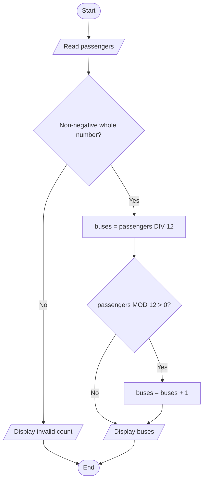

# 1. Learn: Algorithms

Break a problem into clear steps.

You can do this lesson on paper. Python is introduced in Topic 06. Read sections 1–5 in one sitting; keep the puzzle workshops for a separate session.

## 1. Say what a correct answer means

An **algorithm** is a finite, ordered set of clear instructions for solving a problem. A **program** expresses an algorithm in a programming language.

Our problem: book the fewest minibuses for a school outing. Each bus has **12 available passenger seats**.

| Part of the specification | Our rule |
|---|---|
| Input: information supplied | A whole-number passenger count, zero or more |
| Output: information produced | A whole-number bus count |
| Assumptions: facts we rely on | Drivers do not use these 12 seats; all passengers need one seat |
| Invalid input | Report an error for a negative or fractional count |
| Special case | Zero passengers need zero buses |

A **specification** states what must happen. An algorithm gives the steps to make it happen.

**Worked example:** 29 passengers fill two buses (24 seats) and leave five passengers. They need one more bus: **3 buses altogether**.

**Try:** predict the answers for 24 and 25 passengers before reading on.

**Check:** 2 and 3. An exact multiple of the capacity needs no extra bus.

## 2. Use four thinking tools

| Technique | Meaning | Example in this problem |
|---|---|---|
| Decomposition | Split a problem into meaningful smaller tasks | Read the count → check it → calculate buses → display the result |
| Abstraction | Keep relevant details and omit irrelevant ones | Keep available seats; omit paint colour |
| Pattern recognition | Notice a repeated relationship | 1–12 need one bus; 13–24 need two |
| Generalisation | Express a rule that works beyond one example | Use passenger count and capacity instead of memorising “29 needs 3” |

**Try:** a bus loses two passenger seats to carry equipment. Can the algorithm still assume 12 seats?

**Check:** no. Available seats affect the result. Abstraction must not remove a detail that changes the answer.

In an exam answer, connect the term to the scenario: “I omit bus colour because it does not affect available seats.”

## 3. Write the steps in pseudocode

**Pseudocode** describes an algorithm without requiring a particular programming language.

- `DIV` gives the whole-number quotient: `29 DIV 12 = 2`.
- `MOD` gives the remainder: `29 MOD 12 = 5`.
- `←` stores a value in a named variable. `buses ← buses + 1` increases its stored value.

```text
INPUT passengers
IF passengers is not a non-negative whole number THEN
    OUTPUT "Invalid passenger count"
ELSE
    buses ← passengers DIV 12
    IF passengers MOD 12 > 0 THEN
        buses ← buses + 1
    ENDIF
    OUTPUT buses
ENDIF
```

This uses **sequence** (steps in order) and **selection** (choose a path using a condition). **Iteration** means repetition; we use it in the score counter below.

**Try:** trace zero passengers and then 37 passengers.

**Check:** zero has quotient 0 and remainder 0, giving 0 buses. For 37, the quotient is 3 and remainder 1, giving 4 buses. Always adding one would fail at zero and every exact multiple of 12.

## 4. Follow a flowchart

A **flowchart** draws the same decisions and actions. Use arrows to determine the order.

| Shape | Purpose |
|---|---|
| Rounded start/end | Begin or finish |
| Parallelogram | Input or output |
| Rectangle | Process or calculate |
| Diamond | Decision with labelled exits |



**Try:** follow every arrow taken by 24. Which decision takes its No exit?

**Check:** the remainder decision. The input is valid, but `24 MOD 12` is zero.

A loop in a flowchart needs a path back and a path out. “Repeat until valid” stops when valid becomes true; “repeat while invalid” continues while invalid is true. Read the wording carefully.

## 5. Trace changing values

A **trace table** records variable values as instructions execute. Count how many scores are at least 50:

```text
count ← 0
FOR EACH score IN [48, 72, 50, 31]
    IF score >= 50 THEN
        count ← count + 1
    ENDIF
ENDFOR
OUTPUT count
```

`>=` means “greater than or equal to”. Record a row **after** each score:

| Score | At least 50? | Count after this score |
|---:|---|---:|
| Start | — | 0 |
| 48 | No | 0 |
| 72 | Yes | 1 |
| 50 | Yes | 2 |
| 31 | No | 2 |

A **counter** adds one per matching item. An **accumulator** adds a quantity, such as the scores. The final output is 2; the intermediate counts are not outputs unless the algorithm displays them.

**Try:** replace the scores with `[49, 50, 51]`. Then try an empty list.

**Check:** the counts are 0, 1, 2; the final output is 2. Empty input repeats zero times and leaves the count at 0.

### Explain why it works and stops

An **invariant** is a statement that remains true at a chosen point in each loop. Here: “after each score, count equals the number of qualifying scores processed so far.” It is true at the start and each update preserves it.

**Termination** means the algorithm finishes. A loop over four scores stops after four items. A conditional loop needs progress towards a false condition, unless it uses an explicit exit. Repeatedly subtracting 12 from a positive remaining passenger count eventually reaches zero or below.

Test **boundaries**, where the rule changes: 49, 50, 51 for the score counter; 11, 12, 13 for buses. Also test zero, all matches and no matches. Passing examples supplies evidence; explaining the invariant supplies reasoning about the whole process.

## 6. Extend: quick decisions and fair rules

A **heuristic** is a practical rule that can find a useful answer quickly without guaranteeing the best answer. A route planner might visit the nearest unvisited stop next. A short next journey can leave a long final journey, so the rule does not guarantee the shortest complete route.

Trying every stop order becomes expensive as the number of stops grows. Compare methods using a stated measure, such as total kilometres. A fast useful route may suit a time-limited task; a task requiring a guaranteed optimum needs stronger justification.

**Try:** a booking system gives seats to the first people to register online. Name one affected group and an improvement.

**Check:** people with limited internet access may get fewer opportunities. A telephone booking route or a registration window followed by allocation could address that problem. Correct code does not automatically make the chosen rule fair.

## 7. Puzzle workshop: represent a state

A **state** records the information needed at one moment. A **constraint** is a rule that every allowed state or move must obey. A **state space** contains the possible states and moves between them.

A robot carries boxes A, B and C from left to right. It can carry at most one box per trip, or travel empty. A and B must not be left together without the robot. Neither may B and C. Start with everything on the left; finish with everything on the right.

Record `(robot, A, B, C)`, where 0 means left and 1 means right. Start: `(0,0,0,0)`. Goal: `(1,1,1,1)`. Four two-way locations give `2⁴ = 16` possible encodings, including unsafe states.

**Worked first move:** take B right → `(1,0,1,0)`. A and C can safely remain together. Taking A first would leave the forbidden B/C pair alone.

| Trip | Cargo and direction | State after crossing |
|---:|---|---|
| 1 | B right | `(1,0,1,0)` |
| 2 | Empty left | `(0,0,1,0)` |
| 3 | A right | `(1,1,1,0)` |
| 4 | B left | `(0,1,0,0)` |
| 5 | C right | `(1,1,0,1)` |
| 6 | Empty left | `(0,1,0,1)` |
| 7 | B right | `(1,1,1,1)` |

**Try:** replace trip 4 with an empty return. What becomes unsafe?

**Check:** A and B are left together on the right without the robot. Some useful moves temporarily move away from the goal.

Draw states as nodes and legal moves as arrows. Mark visited states to avoid repeating a cycle. **Breadth-first search** explores one-move paths, then two-move paths, and so on; equal-cost moves give a shortest path. **Depth-first search** follows one branch before returning to alternatives; it need not find the shortest path first.

## 8. Puzzle workshop: an opponent chooses too

A **game tree** includes the moves each player can choose. Label whose turn it is. “Winning” means winning for the player **about to move**, assuming both play as well as possible.

One pile: remove one or two counters; taking the last wins. With 1 or 2 you can win immediately. With 3, either move gives the opponent 1 or 2, so 3 is losing. With 4, remove one and give the opponent 3.

- Winning position: **some** legal move gives the opponent a losing position.
- Losing position: **every** legal move gives the opponent a winning position.

### Change the rules: two piles

Now remove **any positive number from exactly one pile**. Taking the last counter still wins. Equal piles `(n,n)` are losing: after your move, your opponent can copy it in the other pile, restore equality, and eventually take the last counter. `(0,0)` is losing because no move remains.

For unequal piles, reduce the larger to match the smaller. Here are **all** first moves from `(1,3)`:

| Move | Position given to opponent | Opponent's status |
|---|---|---|
| Remove 1 from first pile | `(0,3)` | Winning: take the remaining pile |
| Remove 1 from second pile | `(1,2)` | Winning: make `(1,1)` |
| Remove 2 from second pile | `(1,1)` | Losing: equal piles |
| Remove 3 from second pile | `(1,0)` | Winning: take the remaining pile |

**Try:** choose a move from `(2,4)`, then from three equal piles `(2,2,2)`.

**Check:** leave `(2,2)` in the first game. Remove one entire pile in the second, again leaving two equal piles. This second result is specific to three equal piles, not a rule for all three-pile positions.

## 9. Puzzle workshop: cover every weighing outcome

Nine balls A–I include exactly one **known heavier** ball. All others weigh the same. A balance has three outcomes: left heavy, right heavy or balance.

1. Weigh A,B,C against D,E,F.
2. Left heavy leaves A,B,C; right heavy leaves D,E,F; balance leaves G,H,I.
3. Weigh the first ball of the remaining group against its second.
4. Left heavy identifies the first; right heavy the second; balance identifies the unweighed third.

This covers every branch. The second action depends on the first outcome: an **adaptive decision tree**.

**Try:** trace B, F and H through the tree.

**Check:** B: left, right. F: right, balance. H: balance, right. Two weighings have at most `3² = 9` outcome paths; one weighing has only three. This strategy therefore uses the minimum number under the stated rules. If the odd ball could be lighter, the problem would have different possibilities.

**Next:** <a href="https://tutors.dev/lab/lc-cs/topic-05-algorithms/book-01-practice">2. Practise: design the bus algorithm</a>. <a href="https://tutors.dev/note/lc-cs/topic-05-algorithms/note-02-feedback">Open the answers</a>.
