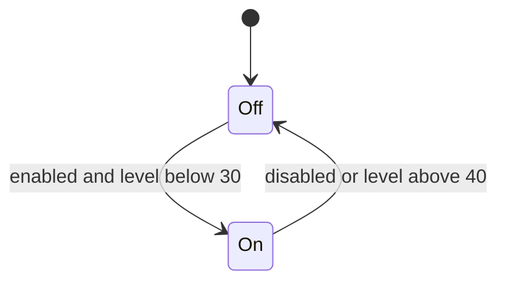

# 1. Learn: Embedded

Connect sensor inputs to useful outputs.

Trace a plant warning indicator on your screen. You can complete this topic without buying or connecting hardware.

## 1. What makes a system embedded?

An **embedded system** is a computer with a specific job inside a product. A washing-machine controller reads inputs and controls a wash cycle. A general-purpose laptop can run many unrelated applications. A **microcontroller** commonly combines a processor, memory, and input/output interfaces on one chip.

An embedded system does not need the Internet. An **Internet of Things (IoT)** device also communicates over a network, which can support remote monitoring but adds power, connectivity, and security concerns.

**Try:** does a thermostat stop being embedded when Wi-Fi fails?

**Check:** no. Its dedicated control role remains. A good design specifies what it should do without a connection.

## 2. Follow one signal

Our example is an indicator, not an automatic pump:

```text
Moisture reading → conversion → decision → warning message
                                  ↑
                             enable button
```

- A **sensor** measures something: moisture, light, or temperature.
- A digital enable button supplies a second input.
- The processor runs the decision rules.
- A display or LED is an output. An **actuator**, such as a motor, changes the physical environment.

**Try:** identify one input, one processing step, and one output above.

**Check:** moisture sensor; compare a converted reading with a threshold; display a warning.

## 3. An ADC code is not a percentage

An **analogue** signal varies across a continuous range. A **digital** signal is interpreted as separate states. An **analogue-to-digital converter (ADC)** takes a voltage reading and represents it with a number.

Ten bits give `2^10 = 1024` possible codes, numbered **0–1023**. The maximum code is not the number of codes. More bits allow finer code steps, but do not automatically make an inaccurate sensor accurate.

For a micro:bit, `read_analog()` returns 0–1023; a digital reading is 0 or 1. `write_analog()` uses **pulse-width modulation (PWM)**: it switches a digital output on and off while varying the fraction of time it is on. It does not create an arbitrary smooth analogue voltage. These details are board-specific; see the [official micro:bit pin reference](https://microbit-micropython.readthedocs.io/en/v2-docs/pin.html).

## 4. Calibrate before interpreting

**Calibration** connects a raw reading with a known reference condition. Our invented dry reference is 800 and wet reference is 300. The sensor's number gets smaller as it gets wetter.

```text
relative level = 100 × (raw − dry) / (wet − dry)
```

| Raw code | Calculation | Relative level |
|---:|---|---:|
| 800 | `100 × 0 / -500` | 0 |
| 550 | `100 × -250 / -500` | 50 |
| 300 | `100 × -500 / -500` | 100 |

**Try:** raw 655 gives `100 × (655−800)/(300−800)`. Predict the result.

**Check:** 29. This is a relative scale between two chosen references, **not a certified percentage of water in soil**.

If dry equals wet, the denominator is zero and the references distinguish nothing. Reject the calibration and investigate. A raw code outside 0–1023 is invalid for this example. A valid code outside the dry/wet references can produce a relative level outside 0–100; report it rather than clipping away evidence. Real sensors need repeated reference measurements and may respond nonlinearly.

## 5. Remember state to avoid flickering

One threshold can flicker when readings move just above and below it. **Hysteresis** uses two thresholds and remembers the previous output.

| Condition | New warning state |
|---|---|
| Monitoring disabled | Off |
| Level below 30 | On |
| Level above 40 | Off |
| Level from 30 to 40, including endpoints | Keep previous state |

Starting off, levels `45, 29, 32, 39, 41` give **off, on, on, on, off**. The warning does not turn off at 32, because it stays on until the reading is above 40.

**Try:** level 35, previously off. Then level 35, previously on.

**Check:** off in the first case, on in the second. The same input can give different outputs because the controller has memory. At exactly 30 or 40, our rules also preserve state. Always test the exact boundaries.



A disabled controller is forced off. Re-enabling at level 20 turns it on again on the next update.

## 6. Time matters as well as the answer

A **real-time system** must respond within a stated deadline. “Fast” is not a sufficient definition. A stop action that arrives after its deadline can be wrong even if the computed result is correct.

**Polling** checks an input repeatedly. An event-driven program reacts to an event. A five-second blocking sleep can delay a button response by almost five seconds. Choose a sampling interval that fits the change you need to detect: soil moisture changes much more slowly than a moving object's position.

A switch can **bounce**, briefly making several electrical transitions during one press. Debouncing prevents them being treated as separate presses. A moving average can smooth noisy sensor readings, but adds delay and can hide short changes. Explain the trade-off before adding a filter.

## 7. Electronics reference: three different components

| Quantity/component | What it means or does |
|---|---|
| Voltage, volts (V) | Electrical potential difference |
| Current, amperes (A) | Rate of charge flow |
| Resistance, ohms (Ω) | Opposition to current |
| Resistor | Limits current or forms part of a voltage divider |
| Capacitor | Stores charge; can smooth a supply or help with timing |
| Transistor | Can act as an electronically controlled switch or amplifier |

For an ohmic resistor, `V = I × R`. With 6 V across 300 Ω, `I = 6/300 = 0.02 A` (20 mA). This is a calculation exercise, not an instruction to wire a particular board. Components are not interchangeable.

## 8. What your simulation proves

A simulator can check conversion formulas, decision logic, boundaries, and sequences. It cannot check wiring, actual sensor response, electrical limits, or physical calibration. Keep the two kinds of evidence separate.

In a supervised hardware extension, use teacher-approved low-voltage parts and an on-board display or indicator. Check supply voltage, pin limits, signal/ground connections, and sensor compatibility before connecting power. An external LED needs appropriate current limiting; motors need suitable drivers and protection. Do not connect mains or power a motor/pump directly from a board pin.

Test components separately before joining them. A useful log records raw reading, converted level, enable state, output, and time. Keep an error indication distinct from a normal reading. Make the output understandable without colour alone. For a real device, record a calibration and a response-time test; those requirements remain even when the software passed its tests.


## Optional discussion: hardware that helps people learn

You can skip streaming and still complete the topic. Compare two imagined light loggers: one costs less but has unclear pin labels; the other has clear labels and a built-in display. Name one advantage, one difficulty, and one test you would run before choosing. A low price helps access, but does not by itself guarantee a suitable learning tool.

If you want a listening prompt, [balenaPodcast's interview with Eben Upton](https://open.spotify.com/episode/4XJBARiHmj0vwcszygKieJ) discusses hardware and computing education. Listen for one design constraint and connect it to the comparison above. The written task is an original alternative, not a transcript.

---

**Next:** <a href="https://tutors.dev/lab/lc-cs/topic-12-embedded-systems/book-01-practice">2. Practise</a>. <a href="https://tutors.dev/note/lc-cs/topic-12-embedded-systems/note-02-feedback">Open the answers when you have tried it</a>.
